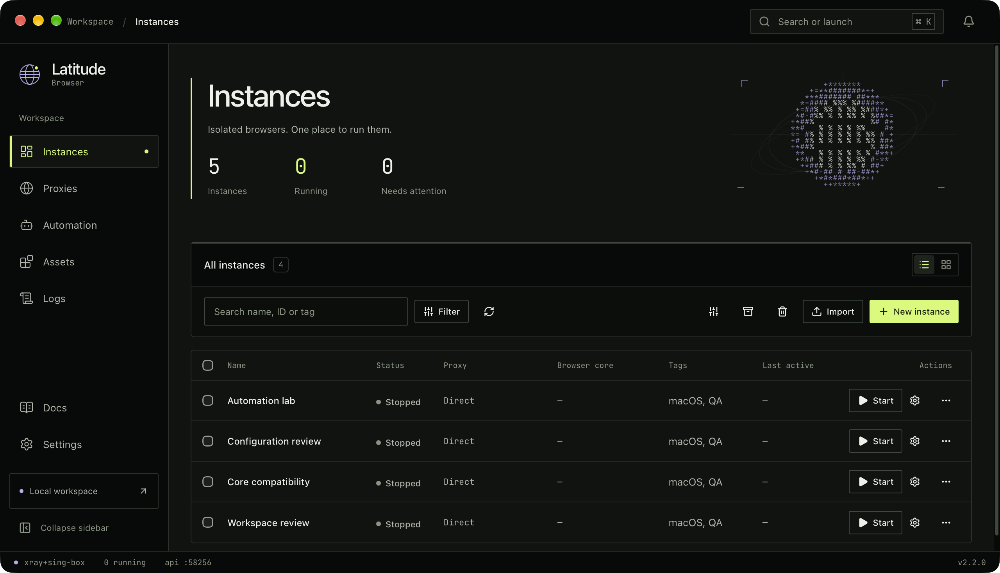
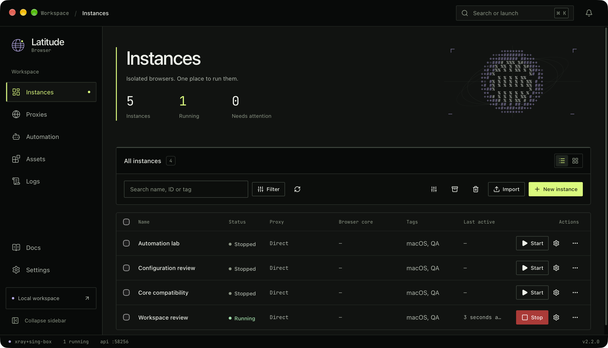

<div align="center">
  
  <h1>Latitude Browser</h1>
  <p>Isolated browser workspaces. Explicit network routes. Local automation.</p>
  <p><strong>2.2.0 · Fieldwork</strong> · English / 简体中文 · Go / Wails / React</p>
  <p><a href="README.md">简体中文</a> · <a href="https://latitude.de5.net/">Website</a> · <a href="docs/showcase/ENGINEERING.md">Engineering</a> · <a href="LICENSE-SCOPE.md">Noncommercial license</a></p>
</div>



Latitude Browser brings browser profiles, proxy connections, cores, extensions and automation into one local desktop workspace. It is intended for permitted noncommercial work that needs separate browser environments and repeatable web workflows.

The screenshot shows the installed macOS application with disposable QA data and four real test configurations. The overview total also includes the profile automatically created by the App. No personal accounts or production proxies were used. See [screenshot provenance](docs/showcase/DEMO.md).

## From configuration to a running browser

| Capability | What it provides |
| --- | --- |
| Profiles | Create, edit, copy, group, tag, search, batch start/stop, trash and migration packages |
| Browser cores | Register, scan, download and bind multiple cores; retain the configured Chrome 148 default and optional 157 choice |
| Network routes | Direct connections, proxy pools, chains, latency checks and exit diagnostics with an explicit connector stack |
| Automation | Local scripts, execution history, Launch API, runtime sessions and CDP integration |
| Local assets | Extensions, bookmarks, cookies, snapshots, configuration backup and restore |
| Desktop controls | Live English/Chinese switching, table/card views, ⌘/Ctrl K quick launch, skippable startup and direct quit |

**Connections follow the selected stack.** `xray` means Xray + sing-box: Xray handles vmess/vless/trojan/shadowsocks/chains, while sing-box handles hysteria2/tuic/anytls. `mihomo` is independent. Launch, latency checks, diagnostics and downloads do not automatically mix stacks. Read the [connector contract](docs/proxy-connector-stacks.md).

Stock Chrome does not implement every patched fingerprint flag. Browser cores are installed separately, and the redesign does not rewrite existing profile bindings. Tor remains experimental and requires a separately configured runtime.

## Fieldwork

A black canvas, sharp borders, lime actions and a lilac identity object carry through tables, forms, settings and dialogs. The pointer disturbs character particles that spring back to rest. Selection, table/card changes and detail navigation transform the same object. Stop and destructive actions use red; running counts and connector selection come from application state.

The field is a locally drawn identity illustration. It stops requesting frames when settled, snaps under reduced motion and keeps an SVG fallback when Canvas is unavailable. Startup remains skippable. Read the [design contract](DESIGN.md) for how the four complete reference prompts were adapted into one system.

Quitting no longer opens a warning or confirmation. Native close starts managed runtime cleanup and exits when it finishes. Rendering failures offer recovery, and empty fingerprint arguments no longer blank the profile list.



## Install and get started

The source version is **2.2.0**, with a verified local macOS arm64 build. Follow the instructions below to build from source, or visit the [official website](https://latitude.de5.net/) for an overview.

The sole macOS installation is `/Applications/Latitude Browser.app`, with Bundle ID `com.latitude.browser.desktop`. Register or download a core in Assets → Browser cores, then create a profile and choose its network route. Existing installations retain their data and default core. Writable state lives in `~/Library/Application Support/latitude-browser`.

Local packages use ad-hoc signing and are not Developer ID signed or notarized. Windows and Linux build paths remain available in source; those platforms were not exercised on real devices in this pass.

## Build from source

Use the Go version in `go.mod`, Node.js 22.12+ and Python 3. macOS also requires Xcode Command Line Tools. Match the Wails CLI to `go.mod`:

```bash
go install github.com/wailsapp/wails/v2/cmd/wails@v2.17.1
npm --prefix frontend ci
npm --prefix frontend run build:clean
wails build -s
```

Build and validate the full macOS package:

```bash
bash publish/mac/publish-mac.sh --arch arm64
python3 publish/mac/artifact_contract.py validate \
  --manifest publish/output/manifest-macos-arm64.json --arch arm64
```

Artifacts go to `publish/output/`. Packaging checks runtimes, icons, signatures and identity, keeps inspection bundles in `.noindex`, and removes the transient `build/bin` application. Launch tests always use `/Applications`. See the [macOS](publish/mac/README.md) and [Linux](publish/linux/README.md) guides.

For a UI-only preview:

```bash
cd frontend
npm run demo
```

The preview explicitly displays “Mock data.” It does not prove that browsers, proxies or automation actually ran.

## Verification and repository map

```bash
npm --prefix frontend test
go test ./backend/...
python3 tools/check-showcase.py
```

Version 2.2 passed frontend and Wails builds, 124 frontend tests, backend tests, 34 bilingual/viewport/fallback checks and nine motion/state checks. Native English/Chinese windows were captured from the installed App. Chrome 148.0.7778.215 and 157.0.8103.38 both passed readiness, navigation, back and tab operations with isolated data. Chrome 148 remains the default and 157 optional; normal quit released managed processes and ports. Exact evidence and verification limits are in the [execution result](LATITUDE-APP-REDESIGN-RESULT-2026-11-06.md).

| Path | Responsibility |
| --- | --- |
| `frontend/` | React/TypeScript UI, language layer and shared components |
| `backend/` | Profiles, connector stacks, SQLite, assets, automation and launch service |
| `publish/`, `tools/runtime/` | Packaging, runtime provenance and integrity checks |
| `docs/` | [Engineering](docs/showcase/ENGINEERING.md), [demo](docs/showcase/DEMO.md), connector rules and historical decisions |
| `images/showcase/` | Traceable application screenshots |

[Changelog](CHANGELOG.md) · [Design](DESIGN.md) · [Contributing](CONTRIBUTING.md) · [Security](SECURITY.md) · [Roadmap](ROADMAP.md)

## License and provenance

Maintainer-owned contributions are offered under **PolyForm Noncommercial 1.0.0; commercial use is not licensed**. This is a source-available project. Historical upstream code and third-party components retain their own rights and notices. Read [LICENSE](LICENSE), [license scope](LICENSE-SCOPE.md) and [third-party notices](third_party/NOTICE.md) together; the root license does not relicense all upstream history or dependencies.
