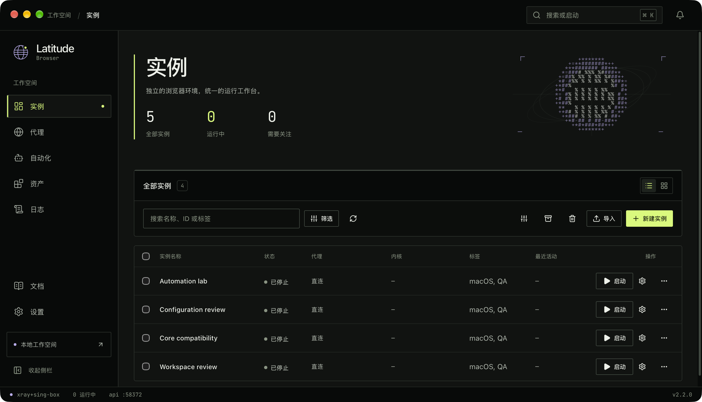
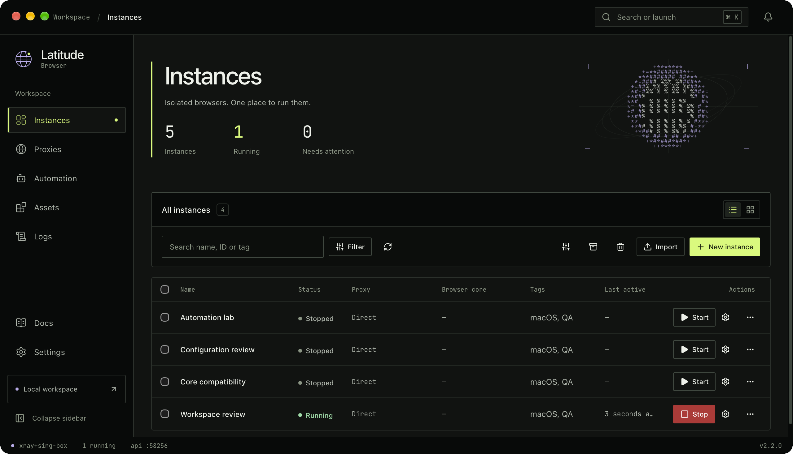

<div align="center">
  
  <h1>Latitude Browser</h1>
  <p>隔离浏览器环境，明确连接路径，在本地完成自动化。</p>
  <p><strong>2.2.0 · Fieldwork</strong> · 简体中文 / English · Go / Wails / React</p>
  <p><a href="README.en.md">English</a> · <a href="https://github.com/djblack1209-coder/Latitude-Browser/releases">下载</a> · <a href="docs/showcase/ENGINEERING.md">工程导览</a> · <a href="LICENSE-SCOPE.md">非商业许可</a></p>
</div>



Latitude Browser 把浏览器实例、代理连接、内核、扩展和自动化放在同一个桌面工作区。适合需要多个独立浏览器环境、重复验证网页流程和管理本地脚本的非商业使用场景。

上图来自正式安装路径的 macOS App，使用独立 QA 数据，显示四个真实创建的测试配置；总数还包含 App 自动建立的默认实例。没有私人账号或生产代理。截图来源与验收边界见[演示说明](docs/showcase/DEMO.md)。

## 一个工作区，从配置到运行

| 能力 | 可以完成什么 |
| --- | --- |
| 实例管理 | 创建、编辑、复制、分组、标签、检索、批量启动/停止、回收站与迁移包 |
| 内核选择 | 多内核登记、扫描、下载与实例绑定；保留已有 Chrome 148 默认配置，157 作为可选项 |
| 代理连接 | 直连、代理池、链式代理、测速与出口诊断；明确选择当前连接栈 |
| 自动化 | 本地脚本、执行记录、Launch API、运行会话与 CDP 接入 |
| 本地资产 | 扩展、书签、Cookie、快照、配置备份与恢复 |
| 桌面体验 | 中英文即时切换、表格/卡片视图、⌘/Ctrl K 快捷启动、可跳过启动层、直接退出 |

**连接栈按选择执行。** `xray` 是 Xray + sing-box 组合：Xray 处理 vmess/vless/trojan/shadowsocks/链式代理等，sing-box 处理 hysteria2/tuic/anytls 等。`mihomo` 是独立栈；启动、测速、诊断和下载不会自动跨栈混用。详见[连接栈约定](docs/proxy-connector-stacks.md)。

普通 Chrome 不实现补丁内核的全部指纹能力。内核由用户独立安装；现有实例绑定不会因界面升级被改写。Tor 保留为需要自行配置运行时的实验功能。

## Fieldwork 界面

黑色画布、锐利边框、荧光绿操作与淡紫身份主体贯穿列表、表单、设置和弹窗。指针会扰动字符粒子并让其归位；选择实例、切换表格/卡片或进入详情时，同一主体连续变换。停止和破坏性操作使用红色，运行数量与连接栈来自应用状态。

字符场是本地绘制的身份插图，静止后停止逐帧渲染；减弱动态效果下直接切换，Canvas 不可用时保留 SVG。启动层仍可直接跳过。四份完整参考提示词的融合方式见[设计约定](DESIGN.md)。

退出不再弹出警告或确认框；原生关闭直接进入受管进程清理，完成后退出。渲染异常提供恢复入口，空指纹参数不会使实例列表变成空白。



## 安装与第一次运行

从[Releases](https://github.com/djblack1209-coder/Latitude-Browser/releases)选择已经发布的平台包。仓库当前版本为 2.2.0；本轮生成并验收了本地 macOS arm64 包，尚未另外创建 2.2.0 GitHub Release。

macOS 只保留一个正式入口：`/Applications/Latitude Browser.app`，Bundle ID 为 `com.latitude.browser.desktop`。启动后在“资产 → 内核”登记或下载内核，再创建实例并选择网络入口。现有安装保留原数据和内核默认项。可写状态位于 `~/Library/Application Support/latitude-browser`。

本地包使用 ad-hoc 签名，未进行 Developer ID 签名或公证。Windows/Linux 的构建入口保留在源码中，本次没有完成这些平台的实机验收。

## 从源码构建

使用 `go.mod` 声明的 Go 版本、Node.js 22.12+、Python 3；macOS 还需 Xcode Command Line Tools。Wails CLI 版本与 `go.mod` 对齐：

```bash
go install github.com/wailsapp/wails/v2/cmd/wails@v2.17.1
npm --prefix frontend ci
npm --prefix frontend run build:clean
wails build -s
```

完整 macOS 分发包：

```bash
bash publish/mac/publish-mac.sh --arch arm64
python3 publish/mac/artifact_contract.py validate \
  --manifest publish/output/manifest-macos-arm64.json --arch arm64
```

构建产物在 `publish/output/`。打包脚本验证代理运行时、图标、签名与应用标识，将临时 `.app` 放入 `.noindex` 目录并移除 `build/bin` 的构建副本；验收始终从 `/Applications` 启动。更多说明见 [macOS](publish/mac/README.md) 与 [Linux](publish/linux/README.md)。

只查看界面：

```bash
cd frontend
npm run demo
```

这是带有“Mock data”提示的开发预览，不等于浏览器、代理或自动化真实运行。

## 验证与工程入口

```bash
npm --prefix frontend test
go test ./backend/...
python3 tools/check-showcase.py
```

2.2.0 已通过前端与 Wails 构建、124 项前端测试、后端测试、34 项双语/尺寸/降级检查和 9 项交互动效检查。正式安装 App 已取得中英文原生截图；Chrome 148.0.7778.215 与 157.0.8103.38 均在隔离资料中通过就绪、导航、后退和标签页开关检查。保持 148 默认、157 可选，正常退出释放所属进程与端口。具体证据和验证边界见[本轮结果](LATITUDE-APP-REDESIGN-RESULT-2026-11-06.md)。

| 路径 | 内容 |
| --- | --- |
| `frontend/` | React / TypeScript 界面、语言层与共享组件 |
| `backend/` | 实例、连接栈、SQLite、资产、自动化和启动服务 |
| `publish/`、`tools/runtime/` | 平台打包、运行时来源与完整性校验 |
| `docs/` | [工程导览](docs/showcase/ENGINEERING.md)、[演示](docs/showcase/DEMO.md)、连接栈与历史决策 |
| `images/showcase/` | 可追溯的实际界面截图 |
| `website/` | 独立网站工作区；本轮 App 重设计未修改或发布网站 |

[更新日志](CHANGELOG.md) · [设计约定](DESIGN.md) · [贡献](CONTRIBUTING.md) · [安全](SECURITY.md) · [后续方向](ROADMAP.md)

## 许可与来源

维护者有权许可的原创贡献采用 **PolyForm Noncommercial 1.0.0：不授予商业使用权**。本项目使用 source-available 表述。历史上游代码与第三方组件保留各自权利和通知；请一并阅读 [LICENSE](LICENSE)、[许可范围](LICENSE-SCOPE.md) 与[第三方声明](third_party/NOTICE.md)。不将维护者的许可解释为对全部上游历史或第三方组件的重新授权。
